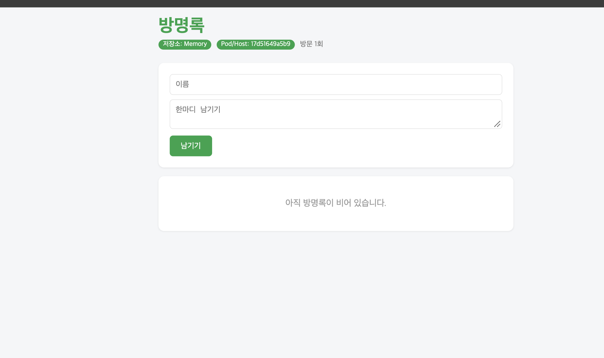

- ghcr.io/seoyoooooni/guestbook:v2

- 

### 학생 과제: 아래 각 줄이 무엇을 하는지 주석으로 설명을 달아보세요.

FROM python:3.12-slim
// 파이썬 3.12의 가벼운 이미지로 시작

WORKDIR /app
// /app을 작업 디렉터리로 지정

COPY requirements.txt .
//requirements.txt 카피
RUN pip install --no-cache-dir -r requirements.txt
// 설차

COPY . .
// 현재폴더 앱파일을 /app에 복사

RUN useradd -m appuser
// 앱 실행할 사용자 생성
USER appuser
//앱을 appuser 권한으로 실행
ENV APP_TITLE="seoyoooooni InhaTC DevOps 방명록!!!!!" \
    THEME_COLOR="#a922b0"

// 앱 제목과 컬러를 환경변수로 설정

EXPOSE 5000
// 5000포트 사용할거라고 문서화

CMD ["python", "app.py"]
// 컨테이너 시작할때 실행

>
[linux/arm64 1/6] FROM docker.io/library/python:3.12-slim@sha256:f77  0.0s
 => => resolve docker.io/library/python:3.12-slim@sha256:f77ac9e44ae96ef  0.0s
 => [internal] load build context                                         0.0s
 => => transferring context: 297B                                         0.0s
 => CACHED [linux/amd64 2/6] WORKDIR /app                                 0.0s
 => CACHED [linux/amd64 3/6] COPY requirements.txt .                      0.0s
 => CACHED [linux/amd64 4/6] RUN pip install --no-cache-dir -r requireme  0.0s
 => [linux/amd64 5/6] COPY . .                                            0.0s
 => CACHED [linux/arm64 2/6] WORKDIR /app                                 0.0s
 => CACHED [linux/arm64 3/6] COPY requirements.txt .                      0.0s
 => CACHED [linux/arm64 4/6] RUN pip install --no-cache-dir -r requireme  0.0s
 => CACHED [linux/arm64 5/6] COPY . .                                     0.0s
 => CACHED [linux/arm64 6/6] RUN useradd -m appuser                       0.0s
 => [linux/amd64 6/6] RUN useradd -m appuser    
>

| 방법 | 사용 |
|---|---|
| **코드** | 환경변수가 전혀 없을 때 사용 |
| **Dockerfile `ENV`** | 이미지에 기본 설정으로 저장 |
| **`docker run -e`** | 해당 컨테이너를 실행할 때 설정 |

>

# Week 06

## 학습 목표

- Dockerfile의 주요 명령과 이미지가 만들어지는 과정을 이해한다.
- 레이어 캐시와 환경 변수의 동작을 설명한다.
- 이미지 태그, 레지스트리 공유, 멀티 아키텍처 빌드의 의미를 이해한다.

### Dockerfile과 이미지 빌드

- Dockerfile은 컨테이너 이미지를 만드는 방법을 기록한 파일이다. 명령에 따라 기반 이미지를 선택하고, 파일을 복사하고, 의존성을 설치하고, 컨테이너의 기본 실행 명령을 정한다.

| 명령 | 역할 |
| --- | --- |
| `FROM` | 기반 이미지 선택 |
| `WORKDIR` | 이후 명령의 작업 디렉터리 설정 |
| `COPY` | 빌드 컨텍스트의 파일을 이미지에 복사 |
| `RUN` | 이미지 빌드 중 명령 실행 |
| `ENV` | 이미지의 기본 환경 변수 설정 |
| `EXPOSE` | 컨테이너에서 사용할 포트 명시 |
| `CMD` | 컨테이너 시작 시 실행할 기본 명령 |

`RUN`은 **이미지를 빌드할 때**, `CMD`는 **컨테이너를 시작할 때** 실행된다. `EXPOSE 5000`은 사용할 포트를 명시할 뿐 호스트에 게시하지 않는다. 호스트에서 접속하려면 실행 시 `-p 8080:5000`처럼 포트를 연결해야 한다.

### 레이어 캐시와 환경 변수

- Dockerfile의 각 단계는 이미지 레이어를 만든다. `requirements.txt`처럼 자주 바뀌지 않는 의존성 파일을 먼저 복사·설치하고 애플리케이션 코드를 나중에 복사하면, 코드만 바뀐 빌드에서 의존성 설치 레이어를 재사용하기 쉽다.

- 설정값은 앱 코드의 기본값, Dockerfile의 `ENV`, 컨테이너 실행 시 지정하는 `-e` 순서로 덮어쓸 수 있다. 이미지에 정한 기본값을 실행 환경에 맞게 바꿀 수 있다는 뜻이다.

### 이미지 태그와 공유

- 이미지는 `ghcr.io/<GitHub-ID>/guestbook:v1`처럼 레지스트리 주소, 저장소 이름, 태그로 식별한다. 태그를 생략하면 `latest`를 사용하며, `latest`가 가장 최근에 만든 이미지를 자동으로 가리키는 것은 아니다. 
- 이미지를 레지스트리에 올리면 다른 사람이 같은 앱과 실행 환경을 내려받아 실행할 수 있다. 컨테이너 실행 중 작성된 데이터까지 이미지에 포함되어 공유되는 것은 아니다.

- 서로 다른 CPU 아키텍처에서 실행할 이미지는 `buildx`의 `--platform` 옵션으로 `linux/amd64`, `linux/arm64` 등을 대상으로 빌드할 수 있다. 이미지의 각 단계와 크기는 `docker history`로 살펴볼 수 있다.
