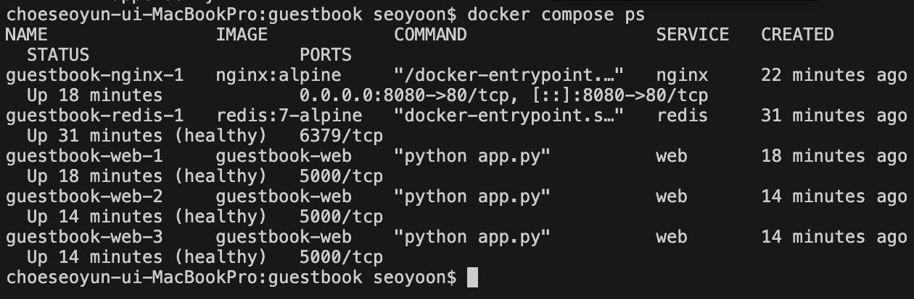
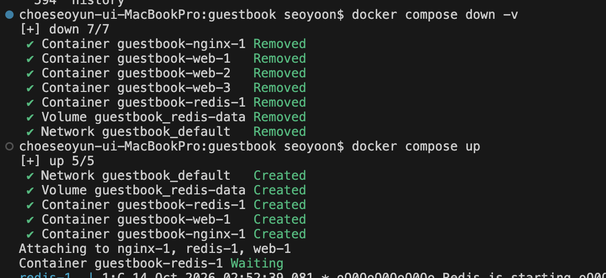
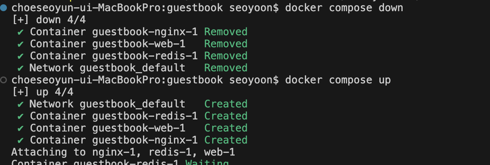

## docker compose ps 결과
- 

## scale 후 각 웹 컨테이너 호스트명이 바뀐 결과 캡쳐
- 
- 
- 

## down 후 up과 down -v 후 up 차이 비교
- 
- 
- -v 하면 volume까지 삭제돼서 데이터가 사라진다.

## .env를 깃에 올리지 않는 이유
- 비밀번호 등 공개하면 안되는 값이 들어있기 때문

>
# Week 07

## 학습 목표

- Docker Compose로 여러 컨테이너를 하나의 애플리케이션으로 구성하는 방법을 이해한다.
- 서비스 간 통신과 볼륨을 통한 데이터 영속화를 설명한다.
- 환경 변수, 준비 상태 확인, 웹 서비스 확장의 핵심 개념을 이해한다.

### 여러 서비스를 하나로 구성하기

- Docker Compose는 `compose.yaml`에 서비스, 네트워크, 볼륨을 정의해 여러 컨테이너를 함께 관리한다.
- 웹 앱은 Compose 네트워크 안에서 Redis 컨테이너의 IP 대신 **서비스 이름 `redis`**로 접속하므로 `REDIS_HOST=redis`를 사용한다.

- 호스트에 포트를 공개하는 설정과 서비스 사이의 통신은 다르다. 웹 서비스의 `8080:5000`은 호스트의 8080 포트를 웹 컨테이너의 5000 포트에 연결한다. Redis 포트를 호스트에 공개하지 않아도 웹 서비스는 Compose 네트워크를 통해 Redis에 접속할 수 있다.

### 데이터 영속화

- 웹 컨테이너만 재시작해도 Redis가 별도 서비스로 동작하므로 저장된 방명록 데이터는 유지된다. 
- Redis의 `/data`를 **named volume**에 연결하면 Redis 컨테이너를 다시 만들어도 데이터가 남는다.

- `docker compose down`은 컨테이너와 네트워크를 내리지만 기본적으로 named volume은 남긴다. `docker compose down -v`는 볼륨도 삭제하므로 저장된 데이터가 사라질 수 있다.

### 설정값과 서비스 준비 상태

- 비밀번호 같은 설정값은 환경 변수로 주입한다. 실제 값을 담은 `.env`는 저장소에서 제외하고, 필요한 변수 이름과 예시 값은 `.env.example`에 기록할 수 있다. 
- Compose에서 `${REDIS_PASSWORD:?비밀번호 설정 필요}` 형식으로 필수 값을 요구할 수 있다.

- `depends_on`의 기본 형태는 컨테이너 시작 순서를 정하지만, Redis가 요청을 처리할 준비가 끝났다는 뜻은 아니다. 
- Redis에 healthcheck를 두고 웹 서비스의 `depends_on` 조건을 `service_healthy`로 지정하면 준비 상태를 기준으로 웹 서비스를 시작할 수 있다.

### 웹 서비스 확장

- 웹 컨테이너를 여러 개로 늘릴 때 각 컨테이너가 같은 호스트 포트 `8080`을 게시하면 포트가 충돌한다. 
- 확장 구성은 nginx만 호스트 포트를 게시하고, 여러 웹 컨테이너는 Compose 네트워크 안에서 5000 포트를 사용한다. 앱 소스와 `compose.yaml`, `nginx.conf`, `.env.example` 같은 구성 파일은 함께 버전 관리할 수 있다.

