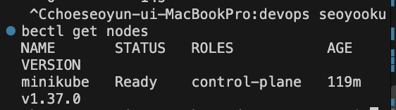
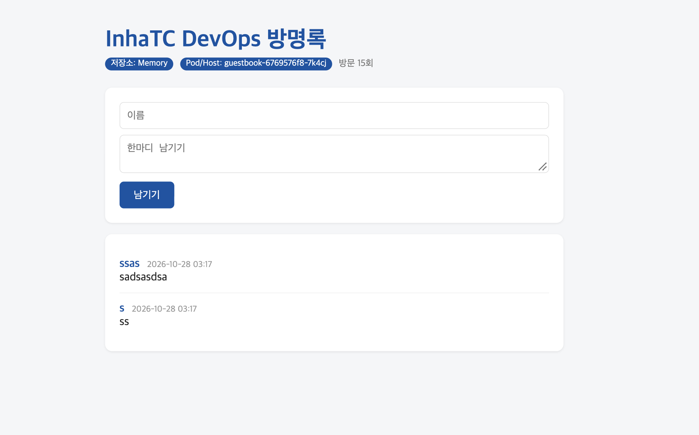
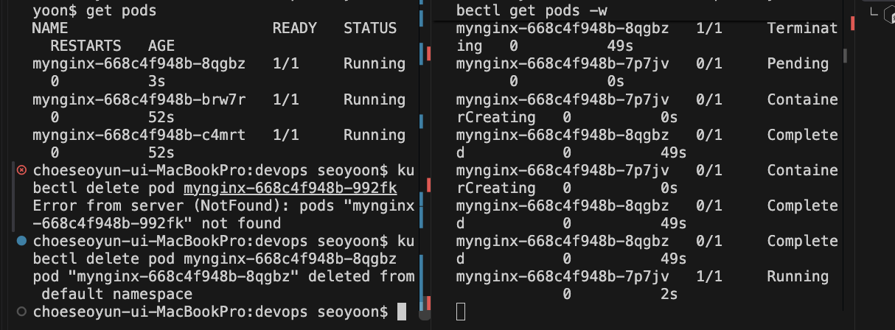
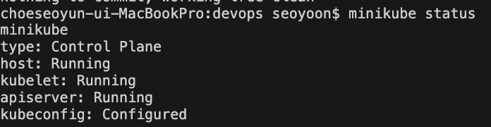
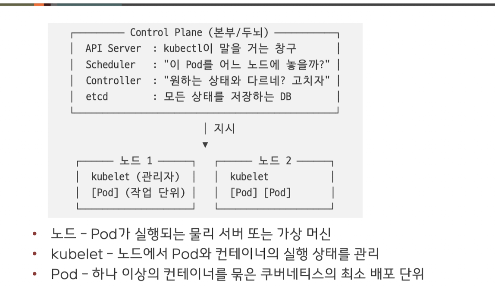

# Week 09

## 혼자해보기

- 선언형: 이런 상태를 원한다 유지해라. 삭제되면 새로 만들고 많아지면 줄여라.

## 학습 목표

- 

### minikube
- 

### 쿠버네티스
- 쿠버네티스는 명령형 명령어도 지원하지만, 원하는 상태를 선언하고 지속적으로 유지하는 것이 핵심
- 명령형: 이렇게 해라(docker run -d nginx), 컨테이너가 죽으면? 직접 다시 run
- 선언형: 이런 상태를 원한다.(replicas: 3) 컨테이너가 죽으면? 쿠버네티스가 알아서 살린다
- 선언형: 현재 상태를 계속 보면서 목표와 다르면 수정

### 조정루프 reconciliation loop
- 1. 관찰: 지금 Pod이 몇개지? 2개
- 2. 비교: 원하는건 3개, 1개부족
- 3. 조치: 그럼 1개 더 만들자. 다시 관찰로 

- 

### 명령어
- $ kubectl run myenginx --image=nginx
- $  kubectl get namespaces
- $ kubectl get pods #default 구역만
- $ kubectl get pods -n kube-system # kube-system 구역만
- kubectl get pods -A #모든 구역

### 용어정리
- 클러스터: 한개 이상의 노드로 구성된 쿠버네티스 관리 환경
- control plane: 클러스터를 관리하는 두뇌
- 노드: 컨테이너가 실제로 도는 서버
- Pod: 컨테이너를 감싼 최소 단위
- 네임스페이스: 클러스터 안의 칸막이
- kubectl: 클러스터에 명령을 보내는 도구

## 실습 
- $ kubectl config current-context #어느 클러스터를 보고있는지 확인. 항상확인해라
- $ kubectl config use-context minikube
- $ kubectl config get-contexts
- $ kubectl get pods -w
- $ kubectl exec -it mynginx -- bash #들어가기, -- 뒤는 옵션이아니고, 컨테이너 안에서 실행할 명령. exit 나오기
- $ kubectl port-forward mynginx 8080:80
Forwarding from 127.0.0.1:8080 -> 80
Forwarding from [::1]:8080 -> 80
Handling connection for 8080
- $ kubectl delete pod mynginx
- $ kubectl create deployment mynginx --image=nginx --replicas=3
-  
해시 번호가 다름 -> 되돌리는 것이 아니라 새로 만드는것. Pod안에 임시저장한 데이터는 사라지니까
데이터는 밖에 저장하자.