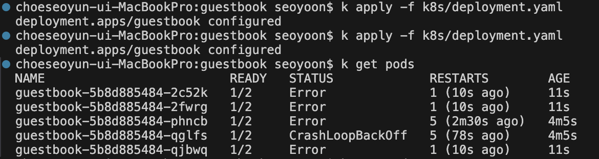
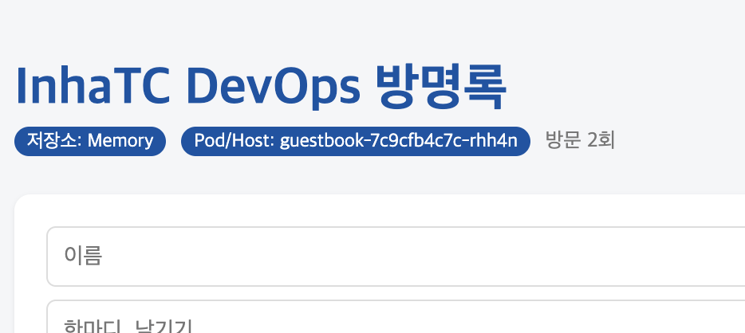
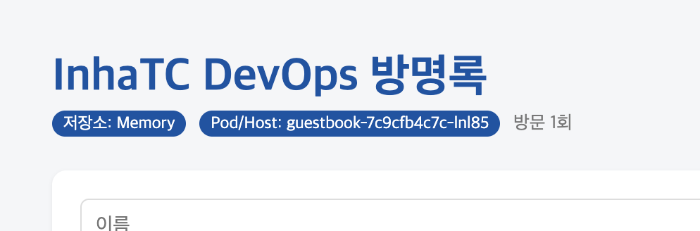
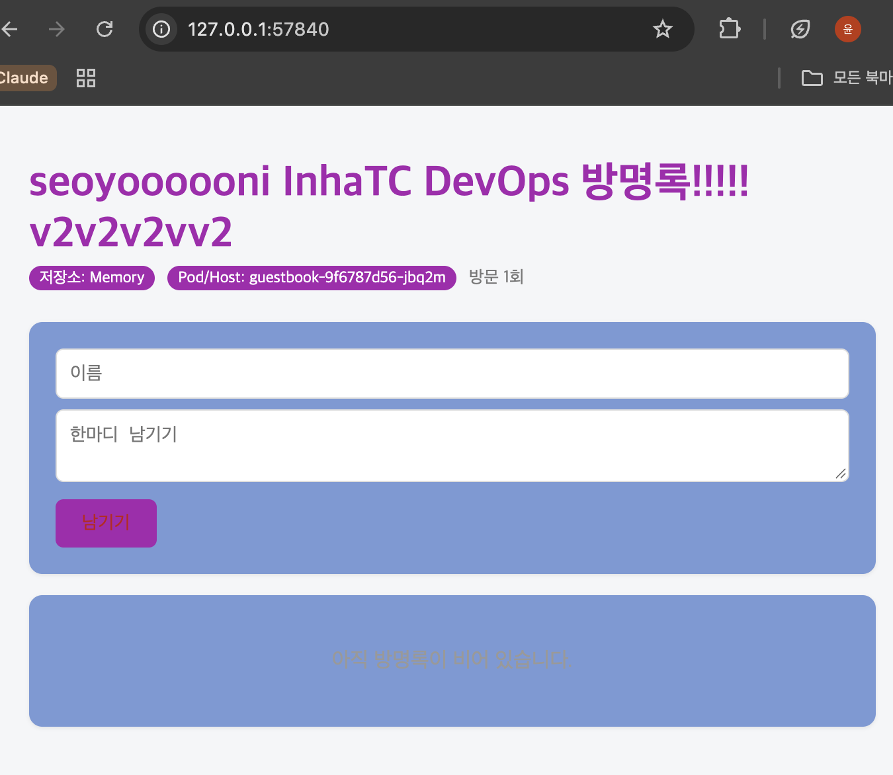

# Week 10

## 혼자해보기

### replicas를 5로 늘리고 kubectl get pods 결과 캡쳐


### 서비스를 통과한 요청에서 서로 다른 Pod hostname 기록



### Pod 하나를 강제 삭제(자동으로 되살아나는 것 확인)
```
$ kubectl delete pod guestbook-5fbbc9689b-l4n5j --force --grace-period=0
pod "guestbook-5fbbc9689b-l4n5j" force deleted from default namespace

$ kubectl get pods -l app=guestbook   # 6초 후
NAME                         READY   STATUS    RESTARTS   AGE
guestbook-5fbbc9689b-q8skz   1/1     Running   0          6m20s
guestbook-5fbbc9689b-tjx7g   1/1     Running   0          6s      ← 새로 생김
guestbook-5fbbc9689b-zzwvc   1/1     Running   0          6m8s
```
- 지운 Pod가 다시 살아난 게 아니라 **이름이 다른 새 Pod**가 생김 (ReplicaSet이 개수를 맞추려고)
- Pod 안에 저장한 데이터는 같이 사라짐 → 방명록 데이터는 Redis에 저장

### v1 -> v2 롤링 업데이트 후 kubectl rollout history 결과 기록
v2 이미지로 바꾼 화면 (11/4 수업)


지금은 Argo CD로 배포해서 PR 하나가 revision 하나가 됨
```
$ kubectl rollout history deployment/guestbook
REVISION  CHANGE-CAUSE
3         <none>
4         <none>
6         <none>
7         <none>
```
| revision | ReplicaSet | 이미지 | 무엇을 했나 |
|---|---|---|---|
| 3 | 7fc85f4467 | guestbook:6087efd | 장애 복구 (PR #15) |
| 4 | df697568c | guestbook:7d63707 | 제목 CI/CD (PR #22) |
| 5→7 | 5fbbc9689b | guestbook:0dfe965 | 디자인 변경 (PR #25) |
| 6 | 7dbcd8bf56 | guestbook:0dfe965 + probe `/healthzz` | 일부러 틀림 (PR #27) |

- 롤링 업데이트: 새 Pod 1개 Ready → 옛 Pod 1개 종료 → 반복 → 서비스 중단 없음
  ```
  22:40:46 옛(1/1) 옛(1/1) 새(0/1)
  22:40:53 옛(1/1) 옛(Terminating) 새(1/1) 새(0/1)
  22:40:59 옛(Terminating) 옛(Terminating) 새(1/1) 새(1/1)
  ```
- CHANGE-CAUSE가 `<none>`인 이유: 변경 이유를 annotation으로 안 남김. 대신 Git 커밋 메시지와 PR에 남아 있음

### 롤백 수행
- 수업 때: `kubectl rollout undo deployment/guestbook`
- 지금은 Argo CD(selfHeal)가 Git 상태로 되돌려 버려서 `rollout undo`가 유지되지 않음 → **`git revert` PR로 롤백** (PR #28)
- revert하니까 revision 5의 ReplicaSet(5fbbc9689b)을 **다시 써서** revision 7이 됨 → 설정이 같으면 새로 안 만들고 옛 ReplicaSet을 재사용 (그래서 5가 목록에서 빠짐)
