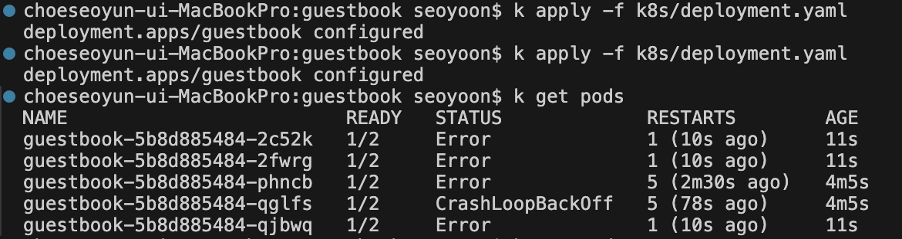
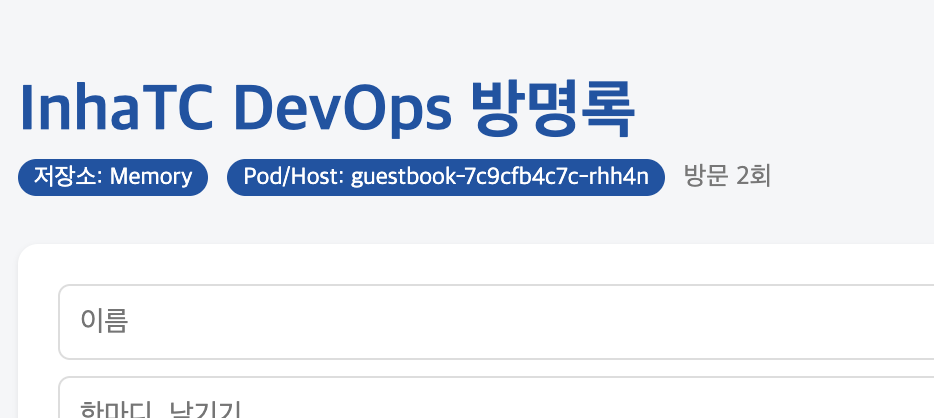
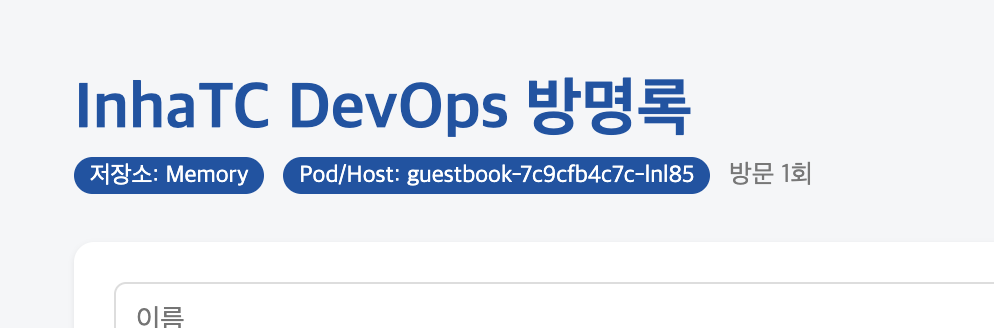

# Week 10

## 혼자해보기

### replicas를 5로 늘리고 kubectl get pods 결과 캡쳐

### 서비스를 통과한 요청에서 서로 다른 Pod hostname 기록

### Pod 하나를 강제 삭제(자동으로 되살아나는 것 확인)
### v1 -> v2 롤링 업데이트 후 kubectl rollout history 결과 기록
### 롤백 수행