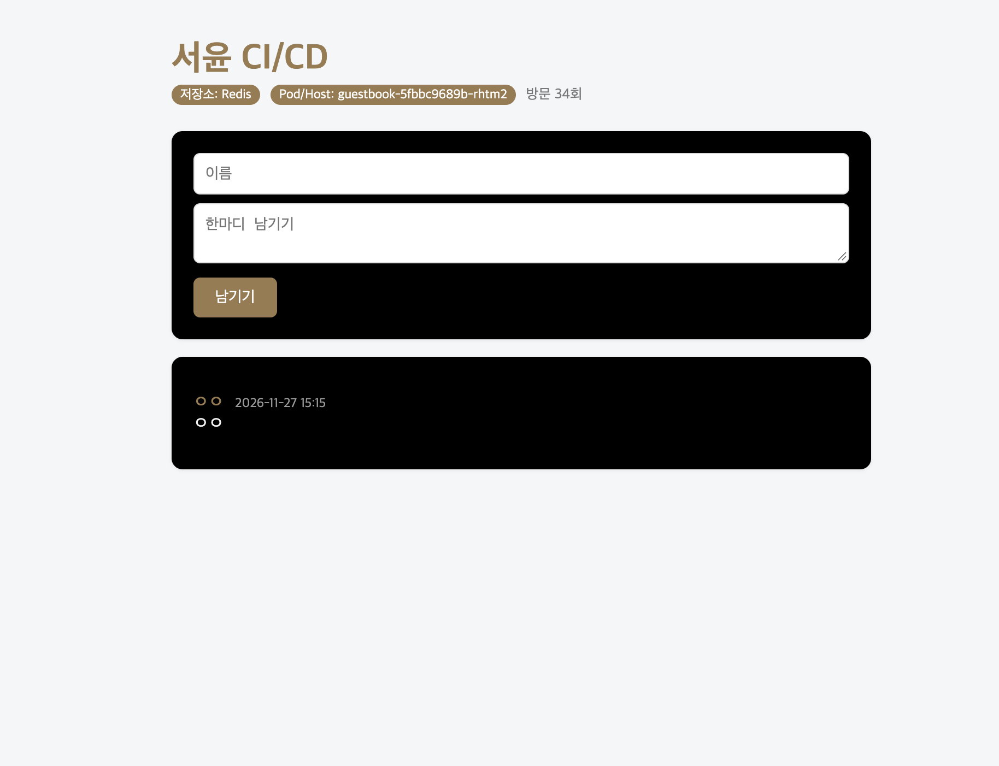
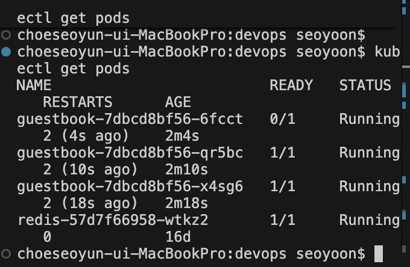
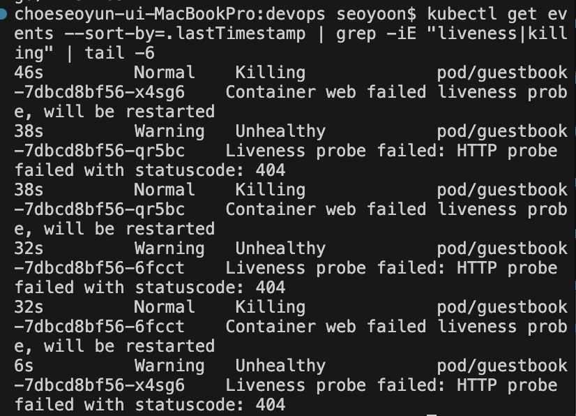

# Week 11 - ConfigMap, Secret, Probe

## 1. Secret을 base64 -d로 읽은 화면
```
$ kubectl get secret guestbook-secret -o yaml | grep REDIS_PASSWORD
  REDIS_PASSWORD: <base64 문자열>

$ kubectl get secret guestbook-secret -o jsonpath="{.data.REDIS_PASSWORD}" | base64 -d
de********      ← 실제로는 비밀번호가 그대로 나옴 (README에는 가림)
```
**왜 안전하지 않은가**
- base64는 **인코딩**(모양만 바꾸기)이지 **암호화**가 아님 → 열쇠 없이 `base64 -d` 한 줄이면 누구나 원래 값으로 되돌림
- Secret을 Git에 올리면 저장소를 볼 수 있는 사람은 다 비밀번호를 볼 수 있음
- 그래서 `secret.yaml`은 `.gitignore`로 빼고, 값 없는 `secret.yaml.example`만 올림 (PR #16)
- 실제로 `.gitignore`에 한 줄 추가하다가 마지막 줄 줄바꿈이 없어서 `secret.yaml` 규칙이 깨진 적 있음 → 커밋 전에 `git status`로 발견 (PR #14)

## 2. ConfigMap만 바꿔서 제목·색이 바뀐 화면
`configmap.yaml`에서 `APP_TITLE: "서윤"`, `THEME_COLOR: "#9a7b4f"`로 바꾸고 PR #21 머지 (이미지 재빌드 없음)

머지 직후:
```
ConfigMap (클러스터)     APP_TITLE=서윤 THEME_COLOR=#9a7b4f
실행 중인 Pod 환경 변수   방명록 (k8s) / #16a34a        ← 아직 옛날 값
화면 제목                 방명록 (k8s) v2v2v2vv2
```
→ 환경 변수는 **Pod가 시작될 때** 한 번 읽음. ConfigMap만 바뀌고 Pod는 그대로라 화면도 그대로

새 Pod가 뜬 뒤 (롤링 업데이트 PR #22):
```
새 Pod 환경 변수   서윤 / #9a7b4f
화면 제목          서윤 CI/CD
```


- 이미지 하나로 설정만 바꿔서 여러 환경(개발/운영)에 쓸 수 있음
- 바로 반영하려면 `kubectl rollout restart deployment guestbook`

## 3. readiness 실패 / liveness 실패

### readiness 실패 (READY 0/1, 재시작 없음)
Redis를 40초 멈추게 함 (`redis-cli CLIENT PAUSE 40000 ALL`) → `/readyz`가 Redis ping에서 막힘
```
10s: q8skz(1/1,R=0) tjx7g(1/1,R=0) zzwvc(1/1,R=0)  endpoint-ready=true,true,true
15s: q8skz(0/1,R=0) tjx7g(0/1,R=0) zzwvc(0/1,R=0)  endpoint-ready=false,false,false
...
45s: q8skz(1/1,R=0) tjx7g(1/1,R=0) zzwvc(1/1,R=0)  endpoint-ready=true,true,true

Readiness probe failed: Get "http://10.244.0.50:5000/readyz": context deadline exceeded
```
- READY 0/1인데 **RESTARTS는 0** → 컨테이너는 살려 두고 Service에서만 빠짐 (endpoint ready=false)
- Redis가 돌아오니까 아무것도 안 했는데 다시 1/1

### liveness 실패 (RESTARTS 증가)
`livenessProbe.path`를 `/healthzz`(없는 경로)로 바꿈 (PR #27)


```
Liveness probe failed: HTTP probe failed with statuscode: 404
Container web failed liveness probe, will be restarted
```
- 404 → 3번 연속 실패 → 컨테이너 **재시작** → 또 404 → RESTARTS 계속 증가
- CI ✅, dry-run ✅, Argo CD Healthy ✅ 다 통과 (문법은 맞고 값만 틀림) → 배포 후 35초 뒤에 드러남
- `git revert` PR #28로 원복

| | readiness | liveness |
|---|---|---|
| 질문 | 요청 받을 준비 됐어? | 살아 있어? |
| 실패하면 | Service에서 빠짐 (READY 0/1) | 컨테이너 재시작 (RESTARTS↑) |
| 내 앱 경로 | `/readyz` (Redis까지 확인) | `/healthz` (앱만 확인) |

## 4. 트러블슈팅 3단 루틴 (내 언어로)
1. **get** — 일단 상태부터 봄. `kubectl get pods` → READY, STATUS, RESTARTS 중 뭐가 이상한지
2. **describe** — 왜 그런지 쿠버네티스가 남긴 메모(Events)를 봄. `kubectl describe pod <이름>` 맨 아래, 또는 `kubectl get events --sort-by=.lastTimestamp`
   (Pod가 여러 개면 `describe -l ... | tail`은 마지막 Pod 설정만 보여서 Events가 잘림 → `get events | grep`이 편함)
3. **logs** — 앱이 직접 한 말을 봄. `kubectl logs <이름>`, 재시작됐으면 `--previous`로 죽기 전 로그

+ 쿠버네티스 YAML은 PR 올리기 전에 `kubectl apply -f guestbook/k8s --dry-run=server`
  (11/25 `kind` 줄이 빠진 PR이 CI를 통과했는데 이걸로 바로 잡힘: `kind not set`)
