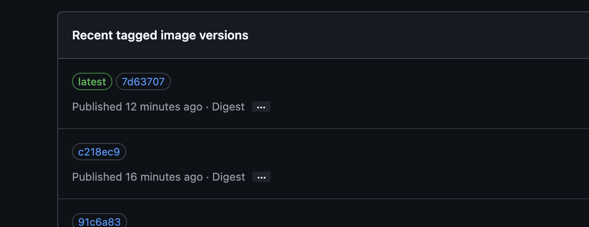
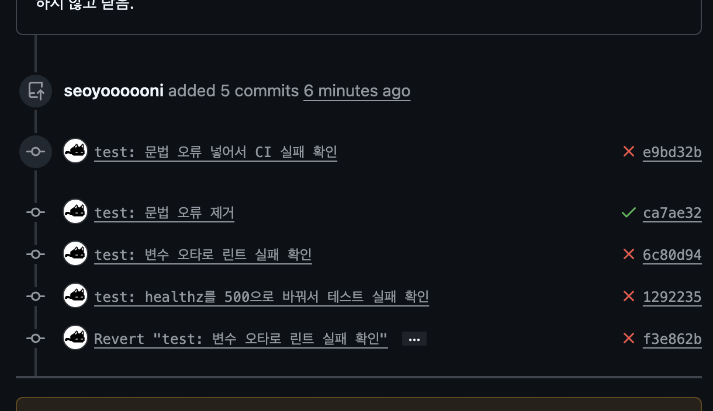
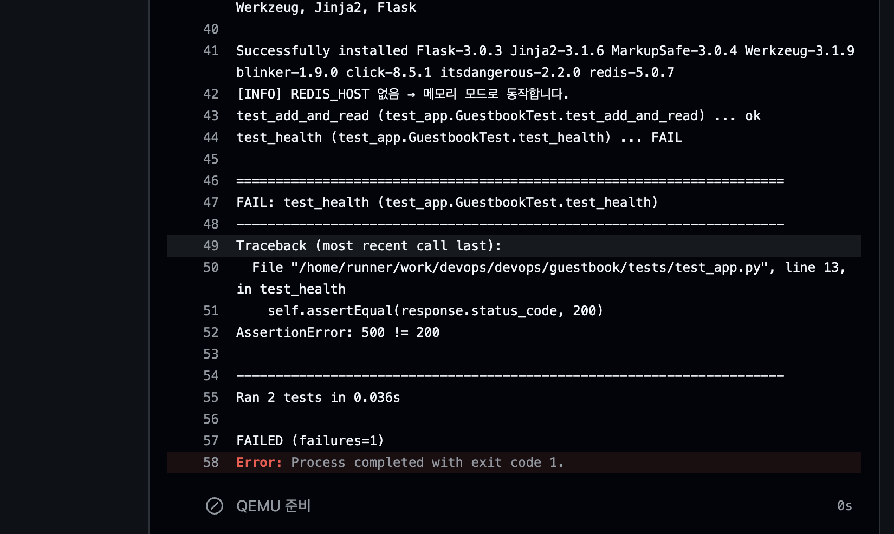

# Week 12 - GitHub Actions (CI)

## 워크플로 구조 (`.github/workflows/build.yml`)

| 용어 | 내 워크플로에서 |
|---|---|
| workflow | `build.yml` 파일 하나 (이름: Build and Push Image) |
| trigger (`on`) | main에 push(guestbook/ 또는 build.yml이 바뀔 때), main 대상 PR, 수동 실행 |
| job | `build` 하나 |
| runner | `ubuntu-latest` (GitHub가 빌려주는 깨끗한 가상 머신) |
| step | 체크아웃 → Python 준비 → 린트(ruff) → 테스트(unittest) → QEMU/Buildx → ghcr 로그인 → 태그 결정 → 빌드 & 푸시 |

- PR에서는 검사 + 빌드만 하고 **푸시는 안 함**, main에 머지됐을 때만 ghcr.io에 푸시
- 이미지 태그 = 커밋 해시 7자리 + latest → 어느 코드로 만든 이미지인지 바로 추적 가능

## 코드 수정 → 이미지 자동 생성

- PR #18 `feat: 제목 문구를 CI/CD로 변경` → CI 초록✓ → 머지
- main CI가 `ghcr.io/seoyoooooni/guestbook:7d63707` 게시 (머지 커밋 `7d63707`)



## 빨간X 실험 (PR #19, 머지하지 않고 닫음)



| 넣은 실수 | 결과 | 잡은 단계 | 시간 |
|---|---|---|---|
| `def broken(:` | `invalid-syntax` | 문법 검사 (ruff E9) | 12초 |
| `print(APP_TITL)` | `F821 Undefined name` | 린트 (ruff F) | 6초 |
| healthz 200 → 500 | `AssertionError: 500 != 200` | 테스트 (unittest) | 8초 |



- `print(APP_TITL)`은 `python -m py_compile`은 통과함 → 문법은 맞는데 없는 변수를 씀. 실행해야 터지는 실수를 린트가 미리 잡음
- 500으로 바꾼 건 문법도 린트도 통과 → 코드를 실제로 실행해 보는 테스트만 잡음
- 문법 검사 = 읽을 수 있나 / 린트 = 실수 패턴이 있나 / 테스트 = 실행했을 때 기대대로 동작하나

**실수**: 린트 실패를 되돌리려고 `git revert -q`를 썼는데 revert에는 `-q` 옵션이 없어서 되돌리기가 안 됨 → 다음 커밋(500)에서 테스트가 아니라 린트에서 먼저 실패. `git log --oneline`으로 확인하고 린트 커밋을 다시 revert해서 해결 (교안 p68 "revert 후에도 빨간X")

## 브랜치 보호

```
$ gh api repos/seoyoooooni/devops/rules/branches/main --jq '.[].type'
deletion
non_fast_forward
pull_request
required_status_checks
```

main에 직접 push 시도:
```
remote: - Changes must be made through a pull request.
remote: - Required status check "build" is expected.
 ! [remote rejected] main -> main (push declined due to repository rule violations)
```
→ 빨간X인 PR은 머지 버튼이 막히고, main 직접 push도 거절됨. 그래서 주차 기록도 브랜치 → PR → 머지 → 태그 순서로 올림

## 정리

- CI는 "합치기 전에 자동으로 검사" → 깨진 코드가 main에 못 들어옴
- 하지만 CI는 **파이썬 코드만** 검사함. 11/25에 `deployment.yaml`에서 `kind`가 빠진 PR(#13)도 CI는 초록✓이었음 → k8s YAML은 `kubectl apply --dry-run=server`로 따로 확인해야 함
- `latest`만 쓰면 지금 어떤 버전이 돌고 있는지, 무엇으로 롤백할지 알 수 없음 → 커밋 해시 태그
