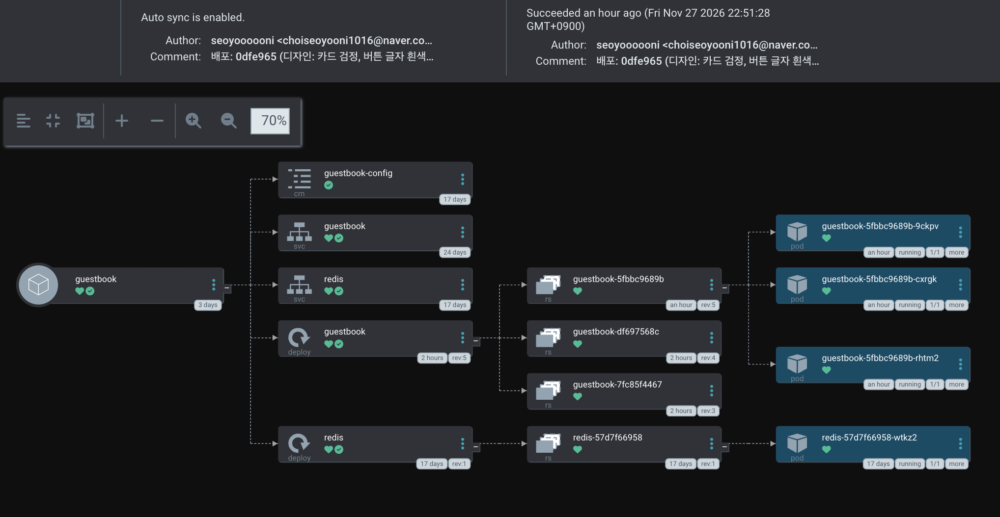
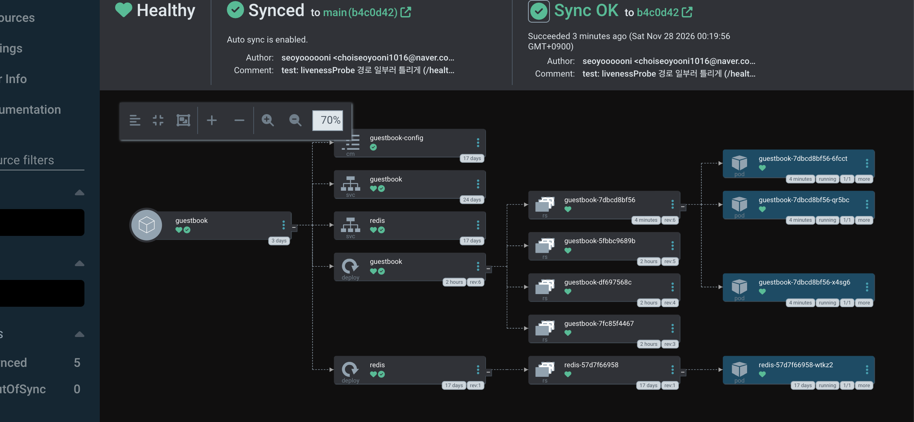

# Week 13 - GitOps (Argo CD), 배포 전략, 모니터링

## Push vs Pull
| | Push (CI가 직접 배포) | Pull (GitOps, Argo CD) |
|---|---|---|
| 클러스터를 바꾸는 주체 | 바깥의 CI 서버 | 클러스터 안의 Argo CD |
| 필요한 권한 | CI에 클러스터 접속 권한 | 바깥에 줄 권한 없음 |
| 배포 기록 | 파이프라인 로그 | Git 히스토리 |
| 누가 손으로 수정하면 | 따로 감지 체계 필요 | 감지하고 되돌림 (selfHeal) |
| 되돌리기 | 이전 파이프라인 재실행 | `git revert` |

→ **Git이 곧 진실.** 클러스터는 Git에 적힌 상태를 따라감

## Argo CD 등록 (`argocd-application.yaml`)
```yaml
source:
  repoURL: https://github.com/seoyoooooni/devops.git
  targetRevision: main
  path: guestbook/k8s        # 이 폴더를 감시
syncPolicy:
  automated:
    prune: true              # Git에서 지우면 클러스터에서도 삭제
    selfHeal: true           # 손으로 바꾸면 Git 값으로 원복
```


## 실습 기록
| 실습 | 한 것 | 결과 |
|---|---|---|
| Git 변경 | replicas 2 → 3 PR (#23) | Pod 3개 (kubectl 안 씀) |
| 손으로 변경 | `kubectl scale --replicas=10` | **6초** 만에 3개로 돌아옴 (selfHeal) |
| 손으로 변경 2 | `kubectl set image ...:7d63707` | **10초** 만에 Git 값(6087efd)으로 돌아옴 → Git에 없는 배포는 인정 안 됨 |
| 롤백 | probe 경로 오타 PR(#27) → `git revert` PR(#28) | `rollout undo`는 selfHeal이 다시 틀린 값으로 돌려 놓음 → Git으로 되돌려야 함 |
| prune | `hello.yaml` 삭제 PR(#17) | 약 10초 뒤 `configmaps "hello" not found` |
| 이미지 배포 | 코드 PR(#18) → CI가 `guestbook:7d63707` 게시 → 태그 PR(#22) | 롤링 업데이트로 제목 "서윤 CI/CD" |

이미지 배포 흐름 (사람이 한 일 = PR 2개 머지)
```
코드 PR → CI(린트·테스트·빌드) → ghcr.io/seoyoooooni/guestbook:<커밋7자리>
       → deployment.yaml image 태그 PR → Argo CD 감지 → 롤링 업데이트
```

### Healthy인데 고장?
- 11/25: `kind: Deployment` 줄이 빠진 파일이 머지됨 → Argo CD는 **Synced / Healthy**인데 guestbook Pod가 0개 (PR #15로 복구)
- 11/28: liveness 경로 오타로 재시작을 반복하는데도 Healthy로 보이는 순간이 있음



→ Argo CD의 초록불은 "Git에 적힌 것과 같다 + 지금 보이는 리소스 상태"까지만 알려줌. Git 파일 자체가 틀리면 못 잡음 → 배포 PR 전에 `kubectl apply --dry-run=server`, 배포 후엔 `kubectl get pods`의 RESTARTS까지 확인

## 배포 전략
| 전략 | 비유 | 감수할 것 | 언제 |
|---|---|---|---|
| Recreate | 가게 문 닫고 인테리어 | 그 사이 서비스 중단 | 두 버전이 같이 돌면 안 될 때 (DB 구조 변경) |
| RollingUpdate (기본) | 직원 한 명씩 교대 | 잠깐 두 버전이 섞임 | 평소의 작은 배포 ← 이번 프로젝트 |
| Blue/Green | 옆에 새 매장 차리고 간판만 교체 | 두 환경 유지하는 동안 자원 2배 | 문제 생기면 즉시 통째로 되돌려야 할 때 |
| Canary | 손님 10%만 새 메뉴 | 지켜볼 사람(모니터링) 필요 | 큰 변경을 일부에게 먼저 |

- A/B 테스트는 배포 전략이 아니라 배포 위에서 하는 **실험** (예: THEME_COLOR 베이지 vs 초록 중 어느 쪽이 글을 더 많이 남기게 하나)

## 모니터링

### kubectl top
```
$ minikube addons enable metrics-server
$ kubectl top pods -l app=guestbook   # 평소
guestbook-5fbbc9689b-q8skz   6m    32Mi
guestbook-5fbbc9689b-tjx7g   7m    29Mi
guestbook-5fbbc9689b-zzwvc   19m   34Mi

$ kubectl run load --image=busybox --restart=Never -- sh -c "while true; do wget -q -O /dev/null http://guestbook/; done"
$ kubectl top pods   # 부하 1분 후
guestbook-5fbbc9689b-q8skz   50m   34Mi
guestbook-5fbbc9689b-tjx7g   64m   31Mi
guestbook-5fbbc9689b-zzwvc   59m   35Mi
load                         447m  6Mi
$ kubectl delete pod load
```
- `m` = 밀리코어 (1000m = CPU 1개), `Mi` = 메비바이트
- 부하를 주니 CPU가 3~8배(6~19m → 50~64m), 3개 Pod에 고르게 나뉨 (Service 로드밸런싱)
- 메모리는 거의 그대로 (~30Mi) → limits 128Mi, CPU limits 500m까지 여유 있음 (포화 아님)

### Prometheus/Grafana 설치하다 클러스터가 멈춤
- `helm install monitoring prometheus-community/kube-prometheus-stack` 중에 kubectl이 `TLS handshake timeout`
- `docker stats minikube` → 메모리 **3.35GiB / 3.9GiB**, CPU 160% → minikube(4GB)에 Argo CD + Prometheus + Grafana까지 올려서 자원 부족. guestbook Pod도 liveness 실패로 재시작됨
- `helm uninstall` + namespace 삭제로 복구, 모니터링은 `kubectl top`으로
- 모니터링 도구도 자원을 먹는다 → 설치 전에 클러스터 크기부터 확인 (교안: "helm 미설치 시 교안만 참고")

### 메트릭 / 로그 / 트레이스
| | 무엇 | 도구 | 방명록 예 |
|---|---|---|---|
| 메트릭 | 시간에 따른 숫자 | Prometheus | `kubectl top`의 CPU 50m |
| 로그 | 텍스트 기록 | Loki, ELK | `[INFO] Redis 연결 성공` (Pod 지우면 같이 사라짐) |
| 트레이스 | 요청의 여정 | Jaeger | 글 목록이 왜 3초 걸렸나 |

골든 시그널: 지연(응답 몇 초) / 트래픽(초당 요청) / 에러(500·503 비율) / 포화(CPU·메모리가 limits에 얼마나 가까운지)
